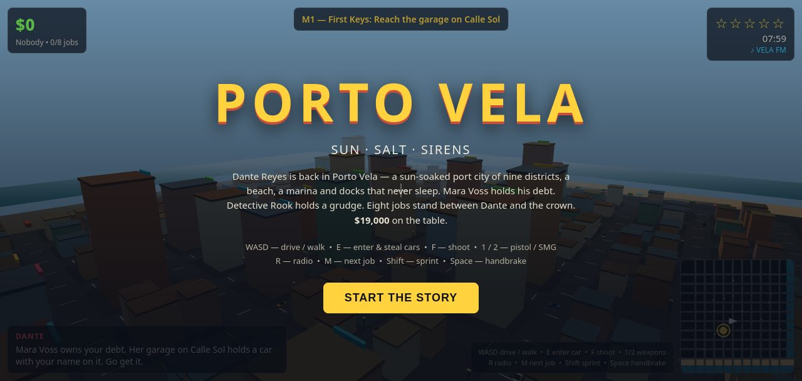
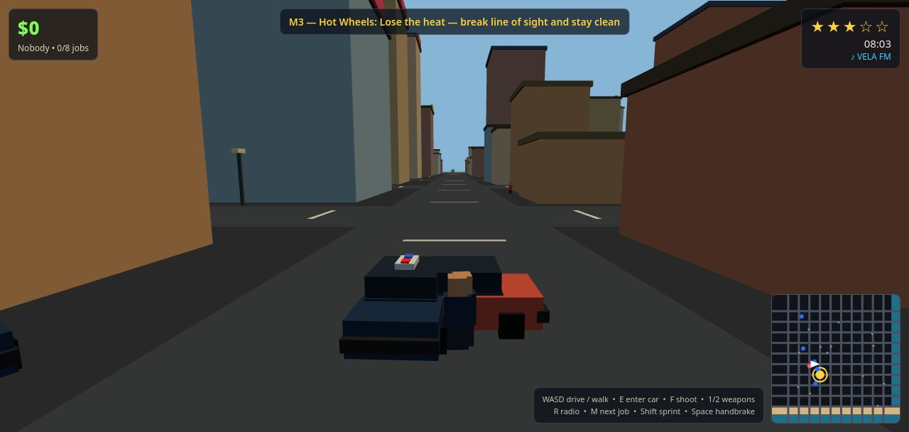
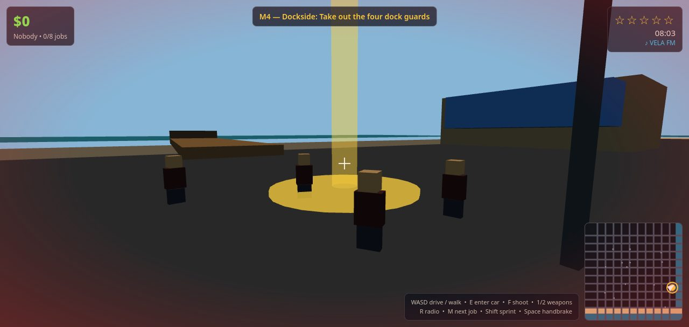
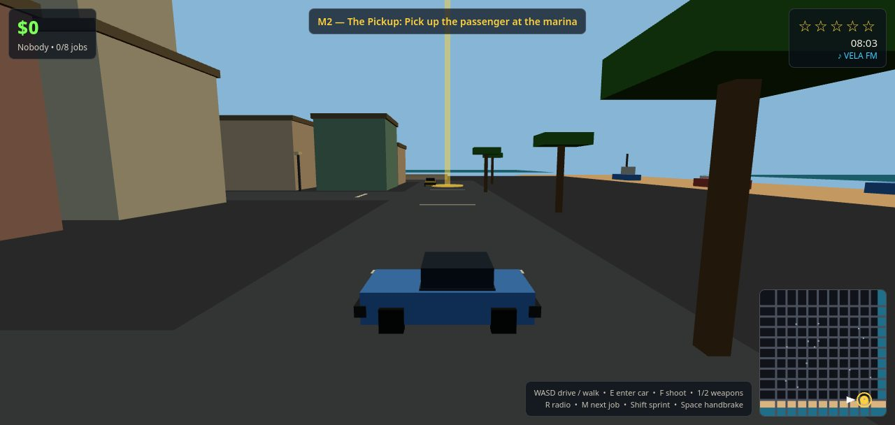

# Porto Vela — an open-world crime game

[](https://make.fun/bounty/gta6-01)
[](https://make.fun/bounty/gta6-01/leaderboard)
[](https://make.fun/bounty/gta6-01)

Entry for the make.fun competition `gta6-01` — build an open-world crime
game in the browser. Porto Vela is a sun-soaked port city of nine
districts, a beach, a marina and docks that never sleep. You are Dante
Reyes, a wheelman back in town with a debt to Mara Voss and Detective
Rook closing in. Eight story jobs stand between you and the crown,
$19,000 on the table.

> New to make.fun? Sign up with my link:
> [https://make.fun/r/hb8k835f](https://make.fun/r/hb8k835f) (code `hb8k835f`).

## Play it

Static files only — no build step, no network at runtime. Serve the
`game/` folder and open it in a desktop browser:

```sh
node serve.ts --port 8092
# open http://localhost:8092/
```

Or serve `game/` with any static server (`python3 -m http.server`,
`npx serve`, …). WebGL2 required.

## Controls

| Key | Does what |
| --- | --- |
| WASD | drive / walk (Shift to sprint on foot) |
| E | enter a car, steal a parked car |
| F / click | shoot (on foot) |
| 1 / 2 | pistol / SMG |
| R | switch radio station |
| M | next job |
| Space | handbrake |
| Esc | pause |

## The eight jobs

1. **First Keys** — $1,000. Take the coupe from Mara's garage on Calle Sol.
2. **The Pickup** — $1,500. A passenger is waiting at the marina. No questions.
3. **Hot Wheels** — $2,000. Three stars on your plate. Lose the heat, then vanish.
4. **Dockside** — $2,500. Four guards on pier 4, then grab the crate.
5. **Courier Run** — $2,000. A package at the beach kiosk, run it to the docks office.
6. **The Sedan** — $2,500. A black sedan with Voss plates, parked by the plaza.
7. **Van Job** — $3,000. A PVPD evidence van rolling through the market district.
8. **Last Stand** — $4,500. Four stars, every cruiser in the city. Survive sixty seconds.

## Systems

- **Wanted, 1–5 stars.** Cruisers hunt you, foot cops move in at 2★,
  the police helicopter circles at 3★+. Break line of sight and the heat
  cools, one star at a time.
- **Traffic AI.** Fourteen cars cruise the grid, slow for you, turn at
  intersections. Parked cars can be stolen — loud is fine, fast is better.
- **Combat.** Pistol and SMG with ammo pickups, body armour that soaks
  damage first, health pickups scattered around the city.
- **Radio.** Three procedural stations (VELA FM, MARINA ROCK, BAY TALK),
  synthesized live with WebAudio — no audio files. Sirens and engine hum
  included.
- **Minimap, HUD, saves.** Live minimap with traffic and police dots,
  cash, wanted stars, clock, mission objective, dialogue, and a save that
  survives a reload.
- **Ranks.** Nobody → Wheelman → Hustler → Shot Caller → Kingpin →
  King of Porto Vela, earned job by job.

## Screenshots

| | |
| --- | --- |
|  |  |
|  |  |

## Self-test

The game ships its own autopilot (`game/src/autopilot.js`, run with
`?autopilot=1`). It plays the real game through the same input pipeline
a human uses — all eight jobs, combat, stealing, heat, saves, radio —
and records 58 checks. Current run: **58/58, $19,000, 0 errors**.

```sh
node ../r5-cdp/cdp-driver.mjs autopilot --port 8092 --timeout-min 35
```

Staged screenshots are in `game/src/shots.js` (`?shot=start|chase|docks|marina`).

## How it is built

- `three` 0.160 (vendored in `game/vendor/`), WebGL2, one merged mesh
  per city layer so the whole city draws in a handful of calls.
- ES modules, no framework, no assets: every texture is a flat colour,
  every sound is synthesized.
- `main.ts` is the entrypoint: it assembles `game/` + `screenshots/`
  into `dossier.json` for the make.fun submission.

## Links

- [gta6-01 bounty](https://make.fun/bounty/gta6-01)
- [make.fun](https://make.fun)
